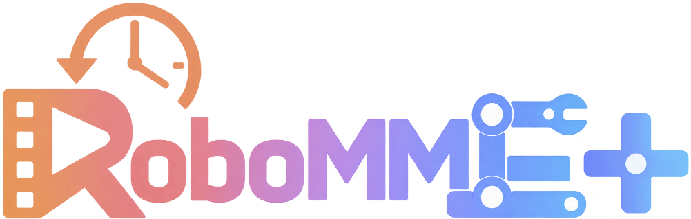

# RoboMME-Plus: Benchmarking Robot Memory under More Demanding Conditions

<p align="center">
  
  <br>
  <a href="https://robomme.github.io/plus.html">Website</a>
</p>

RoboMME-Plus tests robot memory under more demanding conditions. It retains
RoboMME's 16 tasks across counting, permanence, reference and imitation, with
changes to object counts, motion, occlusion, demonstration histories and tools.

## Splits and training data

- **Train:** 50 successful episodes: easy/medium/hard for 15 tasks, plus one example
  for each of MoveCube's five methods. All recordings use 20 Hz control.
- **Test:** 800 episodes, 50 per task. Tiered tasks have 10 easy, 15 medium and
  25 hard episodes; MoveCube has 10 per method. Train/test seeds are disjoint.
- **Downloads:** [H5](https://huggingface.co/datasets/Yinpei/robomme_ood_data_h5) and
  [LeRobot](https://huggingface.co/datasets/Yinpei/robomme_ood_data_lerobot).

Training seeds and episode settings are in
[`env_metadata/train/record_dataset_<Task>_metadata.json`](env_metadata/train/).
Test settings are in [`env_metadata/test/`](env_metadata/test/).
Use `dataset="train"` or `dataset="test"` with `BenchmarkEnvBuilder`.
The [data guide](../../doc/plus_training_data_format.md) describes fields and mappings.
MoveCube's packaged [demonstration controls](assets/demonstrations/MoveCube/)
are replayed through the simulator at reset to produce its conditioning video.

## Evaluation protocol

- **Fine-tuning:** Use only the released **50 training demonstrations** for
  RoboMME-Plus fine-tuning.
- **Interactive adaptation:** RSI-style VLM agents may adapt through simulator
  interaction using only the [50 training seeds](env_metadata/train/), mimicking
  few-shot adaptation in the real world.
- **No source-code access:** Agents must not inspect task implementations or
  receive reverse-engineered task rules. Use task instructions, observations and
  simulator feedback to learn how to solve tasks.
- **General methods:** Use a shared method across tasks. Any task-specific prompts
  or strategies must be discovered by the model from the permitted training
  experience, rather than manually designed for individual tasks or cases.
- **Held-out evaluation:** Reserve test episodes for evaluation. Do not use test
  data, seeds or rollouts to select or tune models, prompts or strategies.

## Task changes

Triples below mean **easy / medium / hard**. Ranges describe the task code;
the fixed seeds may not realize every endpoint. Goals count objects to retrieve.

| Task | RoboMME setup | RoboMME-Plus setup |
| --- | --- | --- |
| **BinFill** | Collect **1–5 cubes** | Collect **6–8 / 3–6 / 3–6 cubes** |
| **PickXtimes** | **1–5** pick-and-place cycles | **6–8 / 5–6 / 7–8** pick-and-place cycles |
| **SwingXtimes** | **1–3** swing cycles; **0 target dodges** | **4–7 / 3–4 / 4–6** cycles; **0 / 0–2 / 0–4** target dodges per visit |
| **StopCube** | Stop on pass **2–5**; **1 trajectory type** | Stop on pass **3–8 / 5–10 / 5–10**; **4 / 4 / 5** trajectory types |
| **VideoUnmask** | **3, 5 or 15 containers**; **1–2 goals** | **5–10 / 11–15 / 16–28 containers**; **3–5 goals** at every level |
| **ButtonUnmask** | **3, 5 or 15 containers**; **1–2 goals** | **6–8 / 8–12 / 16–18 containers**; **3–5 goals** at every level |
| **VideoUnmaskSwap** | **3–4 containers**; **1–2 goals** | **6–8 / 8–10 / 9–12 containers**; **3–5 goals** at every level |
| **ButtonUnmaskSwap** | **3–4 containers**; **1–2 goals** | **6–8 / 9–10 / 11–13 containers**; **3 / 3–4 / 3–4 goals** |
| **PickHighlight** | **3–6 objects**; **1–3 goals**; **90-frame** highlights | **9–10 / 11–13 / 14–17 objects**; **3–5 / 4–6 / 5–9 goals**; **45 / 30–45 / 16–45-step** highlights |
| **VideoRepick** | **3 or 15 cubes**; **1 goal** | **4–6 / 7–10 / 6–10 objects**; **1 goal** at every level |
| **VideoPlaceButton** | **3–4 target rings**; **1 demonstrated cube** | **4 / 6 / 7–8 rings**; **1 / 1 / 2 demonstrated cubes** |
| **VideoPlaceOrder** | **4 rings**; **2–4 placements**; request **1st–4th** | **4 / 6 / 7–8 rings**; **4 / 5 / 5 placements per cube**; request **1st–4th / 1st–5th / 1st–5th** |
| **MoveCube** | **3 manipulation methods** | **5 methods**, **10 test episodes each**; **3 methods available per phase** |
| **InsertPeg** | **34 mm hole**; **20 mm peg**; **0 mm hole shift** | **23–25 / 22–23 / 20.4 mm hole** (easy / medium / hard); **20 mm peg**; **5–10 mm shift along each hole-face axis** |
| **PatternLock** | **2–8 nodes**; **3×3–5×5 grids**; **10 cm** stick | **4–5 / 6–8 / 9–12 nodes**; **5×5 grid**; **10 / 5–7 / 3.5–6 cm** execution stick |
| **RouteStick** | **2–7 segments**; **10 cm** drawing stick | **8–13 / 4–7 / 6–8 curves**; **10 / 2.5–5 / 2.5–5 cm** execution stick |

Medium/hard counting tasks add moving targets or conveyor supply. PickXtimes
requires release on the target followed by a 5 cm upward gripper retreat.
SwingXtimes only credits valid visits after target dodges have settled.

Permanence tasks add repeated colors, denser layouts and occlusion. Swapping
variants move containers. ButtonUnmaskSwap includes finite and continuous motion;
both buttons must be pressed before pickup. Continuous episodes allow neighborhood
pickup pauses after the first 150 execution steps. Each episode's metadata fixes
the motion mode and controller version.

PickHighlight rearranges clusters after simultaneous or staggered cues. Wrong-cube
pickup detection remains active through the final button press; selected cubes
may be put down elsewhere on the table. VideoRepick adds six shapes and moving,
rotating objects. VideoPlace tasks swap rings during the demonstration and require
stable placement, release and a 5 cm upward gripper retreat to finish.

MoveCube requires the demonstrated tool and method, allowing re-grasping of that
tool. Incidental shaft/handle contact may last at most 0.5 s per uninterrupted
contact. See the [method criteria](tasks/imitation/move_cube_support/SUCCESS_CRITERIA.md).
InsertPeg requires the demonstrated peg end and box side, with narrower holes
and shifted hole positions.

PatternLock uses shorter, tilted stick mounts on medium/hard; keep the physical
stick less than 8° from downward vertical. RouteStick keeps a straight mount,
adds shorter sticks and moving obstacles, and permits collisions. Both allow
450 control steps without valid drawing, within the overall execution budget.

## Evaluate

Follow the [installation](../../readme.md#-installation) and
[model adapter guides](../../scripts/plus_eval/README.md), or use your own policy:

```python
from robomme_plus import BenchmarkEnvBuilder

builder = BenchmarkEnvBuilder("VideoRepick", dataset="test", action_space="joint_angle")
env = builder.make_env_for_episode(0)
try:
    obs, info = env.reset()
    goal = info["task_goal"][0]
    while True:
        action = policy.predict(obs, goal, error_message=info.get("error_message"))
        obs, reward, terminated, truncated, info = env.step(action)
        if terminated or truncated:
            success = info.get("status") == "success"
            break
finally:
    env.close()
```

| Interface | Convention |
| --- | --- |
| Action spaces | `joint_angle`, `ee_pose`, `waypoint` |
| Observations | Lists of front/wrist RGB, joints, TCP and gripper state; latest sample is `[-1]` |
| Joint actions | 7 arm joints + gripper; stick tasks use 7 joints |
| Pose/waypoint actions | World-frame `[x, y, z, roll, pitch, yaw, gripper]`, metres/radians |
| Waypoint gripper | `-1` close, `0` keep, `1` open |
| Execution budget | `ceil(1.5 * oracle_policy_step) + 200` control steps; reset/demo excluded |
| Recoverable action error | `info["error_message"]`; 100-step penalty; continue until termination |
| Task failure | `info["failure_reason"]` explains the violated rule |

Preserve reset demonstration frames. Construct a new environment for each episode.
MoveCube ball/cue methods allow two trials; other methods allow one. A retry resets
that episode's scene and execution budget internally.

Only `status == "success"` counts as success. Include failures, timeouts and errors
in the denominator. Keep oracle subgoals and test metadata out of policy inputs.
Report zero-shot and few-shot results separately using the
[submission template](../../doc/submission/model_example_plus.md).

Published dataset URLs and recording format identifiers retain their original
names. Use `robomme_plus` and `RoboMME-Plus/<Task>-v0` in code.
